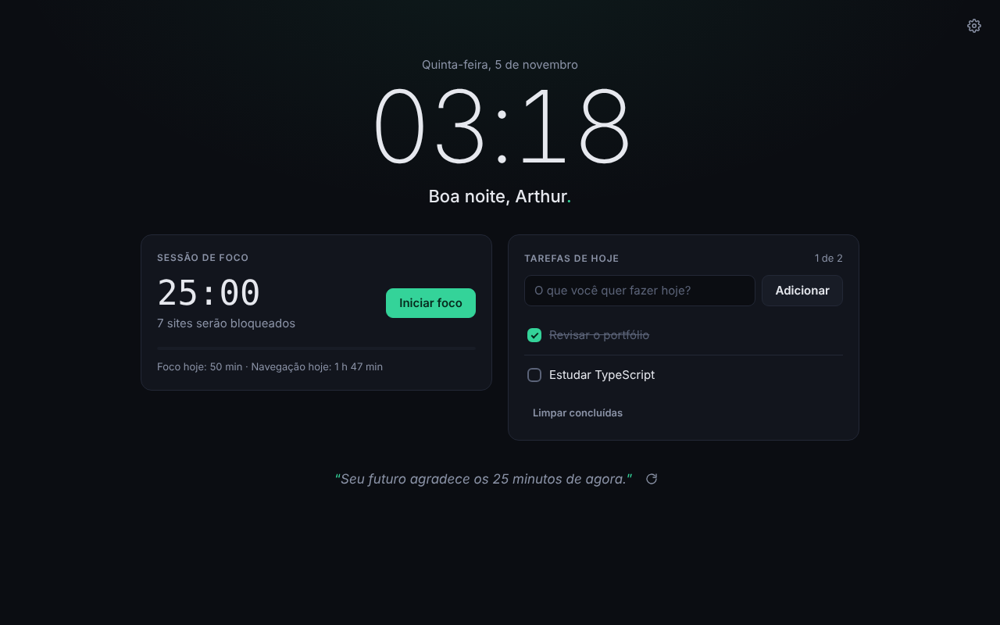
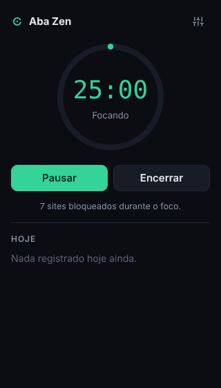
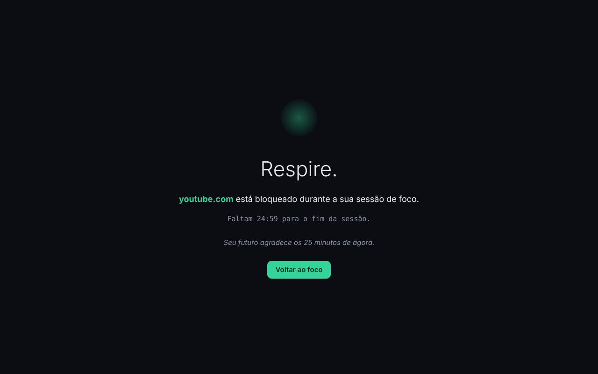

# Aba Zen

Extensão para Google Chrome (Manifest V3) que troca a nova aba por um espaço calmo para planejar o dia e proteger o foco.

Projeto de portfólio de **Arthur Souza Soares**, feito com TypeScript + Vite, sem frameworks de UI e sem nenhum servidor: **todos os dados ficam no seu navegador**.



## Funcionalidades

- **Nova aba personalizada** — relógio, data, saudação pelo nome ("Boa tarde, Arthur."), lista de tarefas do dia e frase motivacional (lista local, sem internet).
- **Tarefas do dia** — adicionar, concluir, remover e limpar concluídas. Na virada do dia as concluídas somem e as pendentes continuam.
- **Sessões de foco com timer** — 15, 25, 50 minutos ou duração personalizada (1 a 180). Iniciar, pausar, retomar e encerrar pelo popup ou pela nova aba. O tempo restante aparece no ícone da extensão.
- **Bloqueio de distrações** — enquanto o timer roda, os sites da sua lista (e seus subdomínios) são bloqueados e você cai na página "Respire.". Na pausa, o bloqueio é suspenso.
- **Estatísticas de tempo por site** — quanto tempo você passou em cada site hoje, nos últimos 7 ou 30 dias, mais os minutos de foco concluídos. Só local: nada é enviado para fora.
- **Página de opções** — nome, duração padrão, lista de bloqueio com validação, ativar/desativar estatísticas e apagar dados.
- **Tema escuro** — fundo `#0b0d12`, destaque verde `#34d399`, textos em português.

| Popup | Página de bloqueio |
| --- | --- |
|  |  |

## Instalação (modo desenvolvedor — "Carregar sem compactação")

### Opção A: gerar a build no seu computador

Pré-requisitos: [Node.js](https://nodejs.org/) 22 ou superior e Git.

1. Clone o repositório e entre na pasta:

   ```bash
   git clone https://github.com/ArthurSouzaS/aba-zen.git
   ```

   ```bash
   cd aba-zen
   ```

2. Instale as dependências:

   ```bash
   npm install
   ```

3. Gere a build (cria a pasta `dist/`):

   ```bash
   npm run build
   ```

4. Abra o Chrome e acesse `chrome://extensions`.
5. Ative o **Modo do desenvolvedor** (canto superior direito).
6. Clique em **Carregar sem compactação** e selecione a pasta **`dist`** do projeto (não a raiz).
7. Abra uma nova aba. Se o Chrome perguntar se deseja manter a alteração da página "Nova guia", escolha **Manter**.
8. Opcional: clique no ícone de quebra-cabeça da barra do Chrome e fixe o **Aba Zen** para acessar o popup com um clique.

### Opção B: usar o .zip gerado pelo GitHub Actions

1. Na aba **Actions** do repositório, abra a execução mais recente do workflow **Build da extensão**.
2. Em **Artifacts**, baixe `aba-zen-vX.Y.Z`. O GitHub entrega um `.zip` que contém o `aba-zen-vX.Y.Z.zip` da extensão.
3. Extraia o `.zip` da extensão em uma pasta (por exemplo, `aba-zen`).
4. Siga os passos 4 a 8 acima, selecionando a pasta extraída (a que contém o `manifest.json`).

### Atualizando

Depois de alterar o código, rode `npm run build` de novo e clique no botão de recarregar (↻) do card do Aba Zen em `chrome://extensions`. Durante o desenvolvimento, `npm run dev` recompila automaticamente a cada alteração.

## Permissões e privacidade

O Aba Zen pede apenas o necessário. Não há permissões de acesso ao conteúdo dos sites (`host_permissions`), nem scripts injetados em páginas, nem requisições de rede.

| Permissão | Por que é necessária |
| --- | --- |
| `storage` | Guardar configurações, tarefas, estado do timer e estatísticas no próprio navegador (`chrome.storage`). |
| `alarms` | Encerrar a sessão de foco no horário certo mesmo com o service worker suspenso, e fechar a medição de tempo a cada minuto. |
| `declarativeNetRequest` | Bloquear os sites da lista durante o foco. As regras são criadas ao iniciar e removidas ao pausar ou encerrar. Usamos a ação `block`, que não exige acesso aos sites. |
| `tabs` | Ler a URL da aba ativa para somar tempo por site e trocar uma aba bloqueada pela página "Respire.". O Chrome mostra o aviso "Ler seu histórico de navegação" por causa dela. |
| `idle` | Parar de contar tempo quando você fica 1 minuto sem usar o computador. Não gera aviso na instalação. |

A substituição da nova aba (`chrome_url_overrides`) e o popup não exigem permissões.

**Sobre os dados:** as estatísticas guardam só o domínio (ex.: `github.com`) e os milissegundos por dia, nunca a URL completa, o título ou o conteúdo das páginas. Ficam 30 dias em `chrome.storage.local` e podem ser apagadas a qualquer momento nas opções. Se preferir, desative o registro: a extensão para de medir na hora.

## Como funciona

```
src/
├── background/index.ts   # service worker: timer, regras de bloqueio, redirecionamento e medição de tempo
├── newtab/               # nova aba (relógio, saudação, foco, tarefas, frase)
├── popup/                # popup do ícone (iniciar/pausar/encerrar, top 3 sites do dia)
├── options/              # página de opções e estatísticas
├── blocked/              # página "Respire." exibida no lugar de sites bloqueados
├── lib/                  # lógica pura e compartilhada
│   ├── timer.ts          # estados do timer (ocioso/rodando/pausado), formatação
│   ├── blocking.ts       # normalização de domínios, correspondência de URLs, regras DNR
│   ├── stats.ts          # trechos de tempo, agregação e retenção
│   ├── tasks.ts          # tarefas do dia e virada de dia
│   ├── storage.ts        # todas as chaves do chrome.storage em um lugar
│   └── ...
├── styles/theme.css      # tokens do tema escuro
└── manifest.ts           # manifest MV3 (versão vem do package.json)
```

- **Timer resistente à suspensão do service worker:** o estado guarda o instante final (`endsAt`), não um contador. Um `chrome.alarms` dispara no fim da sessão e, se o navegador estava dormindo, o próximo evento percebe que o tempo acabou.
- **Bloqueio em duas camadas:** regras `block` do `declarativeNetRequest` impedem o carregamento do site (sem precisar de acesso a ele); em seguida o service worker troca a aba pela página "Respire.", que mostra o tempo restante. Ao iniciar o foco, abas já abertas em sites bloqueados também são redirecionadas.
- **Medição de tempo:** o service worker mantém um "trecho" aberto com o domínio da aba ativa. Trocar de aba, mudar de URL, a janela perder foco, ficar inativo ou a batida do alarme (1 min) fecham o trecho e somam o tempo. Cada trecho vale no máximo 3 minutos, para não contar o tempo em que o computador ficou suspenso.

## Scripts

| Comando | O que faz |
| --- | --- |
| `npm run build` | Gera a extensão em `dist/`. |
| `npm run dev` | Build em modo observação (recompila ao salvar). |
| `npm test` | Roda os testes com Vitest. |
| `npm run typecheck` | Verifica os tipos com o TypeScript. |
| `npm run check` | Tipos + testes + build. |
| `npm run zip` | Build + `aba-zen-vX.Y.Z.zip` na raiz, pronto para a Chrome Web Store. |
| `npm run icons` | Regera os PNGs a partir de `public/icons/icon.svg` (requer Playwright). |

## Testes

A lógica que não depende do Chrome fica em `src/lib` e é testada com Vitest em `tests/`:

- `timer.test.ts` — início, limites de duração, pausa/retomada, transições inválidas, fim da sessão, quando o bloqueio vale, formatação e leitura de estado corrompido.
- `blocking.test.ts` — normalização de domínios (URLs, `www.`, `*.`, portas), entradas inválidas, remoção de duplicatas e subdomínios redundantes, correspondência de URLs (sem falsos positivos como `notyoutube.com`) e geração das regras do `declarativeNetRequest`.
- `stats.test.ts` e `tasks.test.ts` — agregação de tempo, retenção, virada de dia das tarefas, saudação e configurações.

```bash
npm test
```

## Integração contínua

O workflow [`.github/workflows/build.yml`](.github/workflows/build.yml) roda a cada push na `main`, em pull requests, em tags `v*` e manualmente. Ele instala as dependências, checa os tipos, roda os testes, gera o `.zip` da extensão e publica como artefato `aba-zen-vX.Y.Z` (disponível por 30 dias).

## Licença

[MIT](LICENSE) © Arthur Souza Soares
